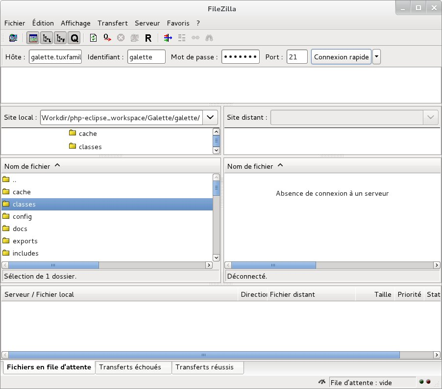
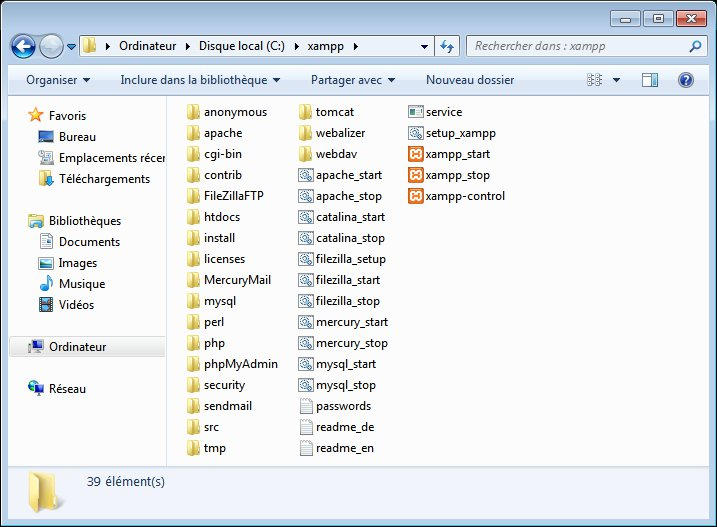
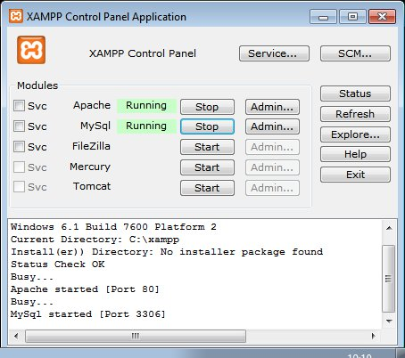

.. include:: /globals.rst
   :start-after: :orphan:

.. _preparation:

***********
Preparation
***********

You have to follow some preparation steps for Galette installation. The way to go differs on what you want to achieve.

.. _archivecontents:

Archive contents
================

The archive contains a single ``galette-1.3.1`` directory, laid out as follows:

::

   galette-1.3.1/
   ├── bin/
   │   └── console        command line interface
   ├── galette/           the application itself
   │   ├── config/
   │   ├── data/
   │   ├── plugins/
   │   ├── webroot/       the only directory the web server should expose
   │   └── ...
   ├── CONTRIBUTING.rst
   ├── LICENSE.md
   ├── README.md
   └── SECURITY.md

What you have to copy on your server:

* the |folder| ``galette`` directory, **mandatory**: it holds the whole application;
* the |folder| ``bin`` directory, **recommended**: it provides the :doc:`command line interface <../command-line>`;
* the remaining files at the root of the archive are informational only; Galette does not need them.

.. _installationdir:

Installation directory
======================

The :ref:`installation example <installation>` extracts the archive in ``/var/www/galette-1.3.1``. This directory, which holds ``bin`` and ``galette``, is called the **installation directory** in this documentation. Unless stated otherwise, paths such as ``config`` or ``data`` are relative to its |folder| ``galette`` subdirectory: ``data`` stands for ``/var/www/galette-1.3.1/galette/data``.

Keeping the version in the directory name is not mandatory, but it makes updates easier: each release gets its own directory, next to the previous one. Updating consists in copying your configuration and data into the new directory, then pointing the web server to it - the previous version stays untouched until you remove it. See :doc:`update <update>`.

The installation directory is created **outside** of the web server document root (often ``/var/www/html``), on purpose: only the |folder| ``galette/webroot`` directory should be reachable from the web.

If your host lets you choose the directory a domain or subdomain points to, point it to ``galette/webroot``, as explained in :ref:`web server directory exposition <installationsubdir>`.

Otherwise (some shared hostings), copy ``galette`` in the published directory. Galette is then available at an URL like ``https://mydomain.tld/galette/``, which redirects to ``https://mydomain.tld/galette/webroot/``. The ``.htaccess`` files shipped in ``data`` directories prevent their contents from being downloaded, but only with Apache: this is less secure than exposing ``webroot`` alone.

.. _droitsfichiers:

File permissions
================

.. warning::

   A commonly used hack is to give all rights to everyone recursively on the directory (``chmod 777``). This is a very very bad idea from a security point of view. Please do not use that hack, you've been warned ;)

Some Galette directories need specific rights. The application will need to write in some of them, you have to ensure it will be possible. Here are directories that need a write access:

* |folder| `config` [#configdirperms]_,
* |folder| `data/attachments`,
* |folder| `data/cache`,
* |folder| `data/exports`,
* |folder| `data/files`,
* |folder| `data/imports`,
* |folder| `data/logs`,
* |folder| `data/photos`,
* |folder| `data/tempimages`,
* |folder| `data/templates_c`

.. [#configdirperms] write access on ``config`` directory is only needed for Galette installation, we advice you to remove the write access once Galette has been installed :)

Create database
===============

.. note::

   **Never use database root user!**

   For security reasons, it is strongly advised to rely on a specific user for Galette database, and give him only requested access on the single Galette database.

For the example, we will use a database named `mygalette` with a user `mygaletteuser` with `mypass` as password.

* MariaDB

  ::

     $ mysql -u root -p
     mysql> CREATE DATABASE mygalette;
     mysql> GRANT ALL ON mygalette.* to
         ->'mygaletteuser'@'localhost' IDENTIFIED BY 'mypass';

* PostgreSQL

  ::

     $ sudo su - postgres
     $ createuser -P mygaletteuser
     $ createdb -O mygaletteuser mygalette

Those commands may vary, please refer to `MariaDB <https://mariadb.com/kb/en/library/documentation/>`_ or `PostgreSQL <https://docs.postgresqlfr.org>`_ documentations, or use a graphical tool:

* `phpMyAdmin <https://www.phpmyadmin.net>`_ for MariaDB ;
* `phpPgAdmin <http://phppgadmin.sourceforge.net>`_ or `PgAdmin <https://www.pgadmin.org/download/?lang=fr_FR>`_ for PostgreSQL.

.. _installationsubdir:

Web server directory exposition
===============================

.. versionadded:: 0.9

Galette installation may consists in copying a complete directory to a location the web server can read. This method may work, but this exposes from the web files and directories that should not be available this way.

It is possible to limit that by exposing only the ``webroot`` directory. All other directories are more safe: it is not possible to reach them from the web server!

The examples below use ``/var/www/galette-1.3.1`` as :ref:`installation directory <installationdir>`.

.. warning::

   Exposing only ``webroot`` directory is the recommended, and only secured way.

Using a subdomain
-----------------

Here is a virtual host configuration example, including the hide of `index.php`:

.. code-block:: apache

   <VirtualHost *:80>
       ServerName galette.localhost

       #https - add *:443 in the <VirtualHost>
       #SSLEngine on
       #SSLProtocol all -SSLv2 -SSLv3
       #Header always add Strict-Transport-Security "max-age=15768000; includeSubDomains; preload"

       #SSLCertificateFile /etc/pki/tls/certs/galette.localhost.crt
       #SSLCertificateChainFile /etc/pki/tls/certs/galette.localhost.chain.crt
       #SSLCertificateKeyFile /etc/pki/tls/private/galette.localhost.key

       DocumentRoot /var/www/galette-1.3.1/galette/webroot/
       <Directory /var/www/galette-1.3.1/galette/webroot/>
           RewriteEngine On
           #You may need to set RewriteBase if you setup
           #rewriting in a .htaccess file for example.
           #RewriteBase /
           RewriteCond %{REQUEST_FILENAME} !-f
           RewriteRule ^(.*)$ index.php [QSA,L]
       </Directory>
   </VirtualHost>

Nginx would be:

.. code-block:: nginx

   server {
       #http
       listen 80;
       listen [::]:80;

       # https
       #listen 443 ssl http2;
       #listen [::]:443 ssl http2;
       #ssl_certificate      /etc/ssl/certs/galette.localhost.pem;
       #ssl_certificate_key  /etc/ssl/private/galette.localhost.key;

       server_name galette.localhost;

       root /var/www/galette-1.3.1/galette/webroot;

       index index.html index.php;

       location / {
           try_files $uri $uri/ @galette;
       }

       location @galette {
           rewrite ^(.*)$ /index.php last;
       }

       location ~ \.php$ {
           include snippets/fastcgi-php.conf;
           # You may have to adapt this path, depending on your distribution.
           fastcgi_pass unix:/run/php/php8.3-fpm.sock;
       }

       location ~ /(data|config|lib)/ {
           deny all;
       }
   }

Using an alias
--------------

An alternative secured configuration, if you do not have a specific subdomain for Galette is to use an ``alias`` in your existing virtual host:

.. code-block:: apache

   <VirtualHost *:80>
       ServerName mydomain.tld

       DocumentRoot /var/www/mydomain.tld

       Alias /mygalette/ /var/www/galette-1.3.1/galette/webroot/
       <Directory /var/www/galette-1.3.1/galette/webroot/>
           RewriteEngine On
           #You need to set RewriteBase to Alias path
           RewriteBase /mygalette/
           RewriteCond %{REQUEST_FILENAME} !-f
           RewriteRule ^(.*)$ index.php [QSA,L]
       </Directory>
   </VirtualHost>

Do not forget with that solution you have to setup correctly your ``RewriteBase`` directive.

.. _installationunix:

Linux/Unix
==========

Installing Galette on Linux implies you have an access to the terminal on the server and required ACLs on directories.

As an example, on `Fedora <https://fedora.org>`_, you will run (as root):

::

   # cd /var/www/galette-1.3.1/galette/
   # chown -R apache:apache config data

Under `Debian <https://debian.org/>`_, we'll replace ``apache:apache`` with ``www-data:www-data``.

On SELinux enabled systems, we'll also add:

::

   # semanage fcontext -a -t httpd_sys_rw_content_t '/var/www/galette-1.3.1/galette/config(/.*)?'
   # semanage fcontext -a -t httpd_sys_rw_content_t '/var/www/galette-1.3.1/galette/data(/.*)?'
   # restorecon -R -v /var/www/galette-1.3.1/

You will also have to authorize webserver to connect to the network, with a SELinux boolean:

::

   # setsebool httpd_can_network_connect on

.. _installationftp:

FTP
===

.. warning::

   Some archive or FTP software may corrupt files... It is strongly advised if you use windows that you use `7zip <https://www.7-zip.fr>`_ to uncompress and `FileZilla <https://filezilla-project.org/>`_ for FTP transfers.

Once source code has been retrieved locally, use :samp:`tar xjvf {galette.tar.bz2}` command under Linux/Unix/MacOS or a graphical tool under Windows.

Just copy the |folder| ``galette`` directory of the uncompressed directory obtained, and all its sub directories and files, with your FTP client.

The |folder| ``bin`` directory is only useful if you have a shell access on your host; if so, copy it next to ``galette``. Other files are not needed, see :ref:`archive contents <archivecontents>`.

Where to copy it on your host is explained in the :ref:`installation directory <installationdir>` section.

Specific cases
==============

Ionos
-----

If you're hosted on Ionos; and want to use a specific subdomain for Galette, you must create your subdomain from their UI, and make it points to the ``webroot`` directory. You also have to edit the ``.htaccess`` file it contains, and uncomment the ``RewriteBase /`` directive.

OVH
---

This hosting company offers to `change PHP version you use from your customer account <https://docs.ovh.com/fr/hosting/configurer-le-php-sur-son-hebergement-web-mutu-2014/>`_.

Additional information are available at: https://docs.ovh.com/fr/fr/web/hosting/configurer-le-php-sur-son-hebergement-web-mutu-2014/

.. warning::

   Many users have display images or attendance sheet issues on OVH hosts. The solution to this issue is to create a ``.ovhconfig`` file at your hosting root with the following contents:

   ::

      app.engine=phpcgi

Nginx
-----

`Nginx webserver <https://nginx.com>`_ configuration is different from Apache one (see `Nginx documentation for a more complete explanation <https://www.nginx.com/resources/wiki/start/topics/examples/likeapache-htaccess/>`_).

So you have to convert restriction access files in Nginx configuration, as for example:

.. code-block:: nginx

   location ~ /(data|config|lib)/ {
       deny all;
   }

.. _installationwindows:

Windows
=======

Installation described here rely on `XAMPP <https://www.apachefriends.org/xampp-windows.html>`_; other installation methods exist but are not listed here.

First of all, download XAMPP on your computer. Let's install it under ``C:\xampp``.

Launch the ``xampp-control`` executable (you can find it in ``C:\xampp``), so you can start Apache and MySQL services.

Once those steps done, download Galette, uncompress it and move the |folder| ``galette`` directory it contains to ``C:\xampp\htdocs\galette``; web application will be available from http://127.0.0.1/galette/. Just visit this URL so the installation process begin.

.. note::

   Enabling PHP modules under XAMPP is done in ``xampp/php/php.ini``. Most of the required extensions are already present, but commented (line begins with a ";"), just uncomment them and restart XAMPP.

   `openssl` extension is missing in the file, to activate it just add the following to your `php.ini`: ``extension=php_openssl.dll``
