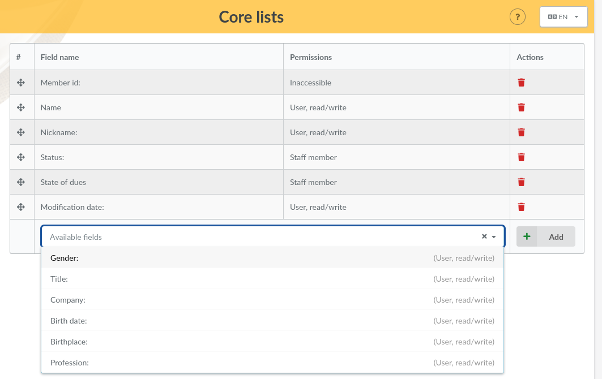
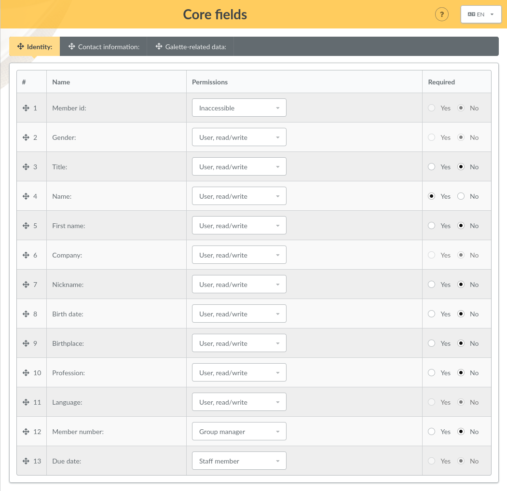
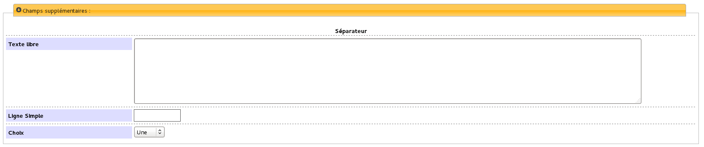
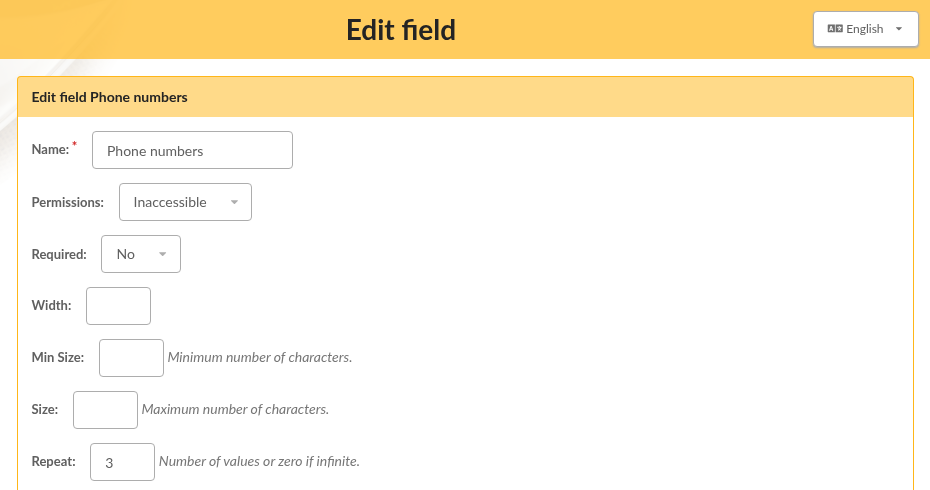
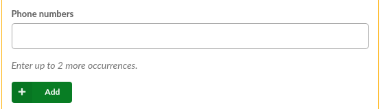
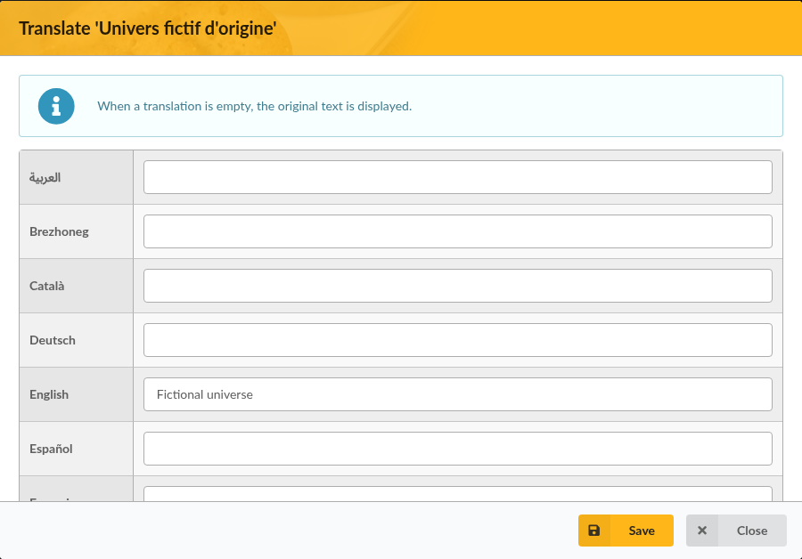
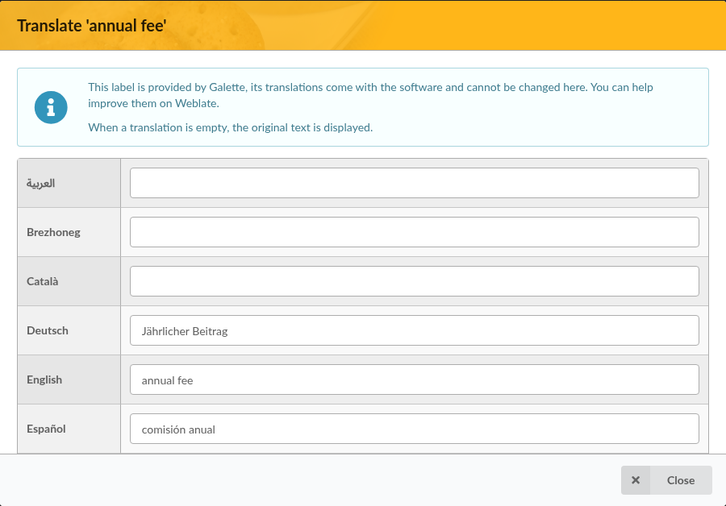
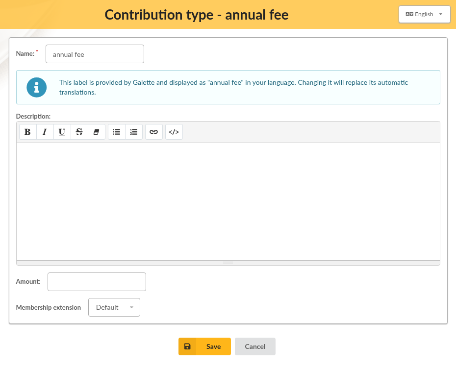
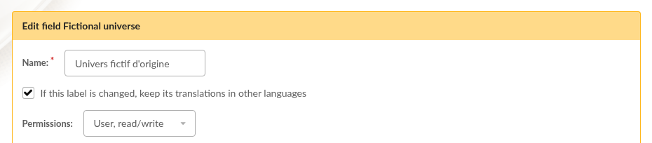
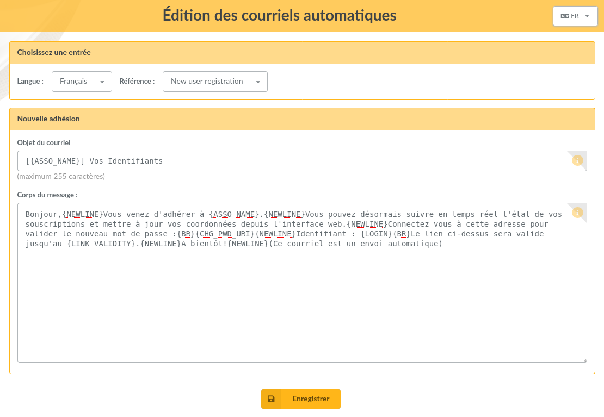

.. _man_configuration:

********************
Fields Configuration
********************

List fields
===========

.. versionadded:: 0.9.4

You can choose which fields will appears on Galette members list and the order they will appear with a drag & drop interface. Related access rights can be set from core fields configuration (see below).

.. note::

    Two fields are mandatory and cannot be moved: member number and name.

    It is not possible to set access rights on id column, and parent will be accessible for staff members only.

.. versionadded:: 1.3.2

Members :ref:`dynamic fields <dynamic_fields>` can be added to the list too; they are flagged with a `Dynamic field` label in the available fields and in the list. Separator and file fields cannot be displayed.

In the members list:

* a dynamic field column is displayed only to users who can see the field, according to its access rights,
* values longer than 20 characters are shortened; hover the value to read it entirely,
* values of a repeatable field are separated with commas,
* a choice displays its label, and a boolean displays `Yes` or `No`.

Removing a dynamic field also removes its column from the list.

.. _fields_acls:

Mandatory fields and access rights
==================================

When you create or edit a member, some fields are mandatory. Default configuration may not suit your needs, but you can configure some elements easily ;)

From the `Configuration`, `Core fields` menu, you will get access to all fields available for members, and choose for each one if it is mandatory or not, as well as associated access rights:

* `inaccessible` will make the field inaccessible for everyone,
* `administrator` will make the field readable and writeable for administrators only,
* `staff members` will make the field readable and writable for staff members and administrators,
* `groups managers` will make the field readable and writable for groups managers on the members of groups they own, and for staff members and administrators,
* `read/write` will make the field readable and writeable for member, groups managers, staff members and administrators,
* `read only` will make the field read only for the members, but writable for groups managers, staff members and administrators.

.. _dynamic_fields:

Dynamic fields
==============

Galette comes per default with many fields for members, contributions and transactions. Some of them will be useless, but you may need fields that does not exists...

In this case, that is quite simple : just add a new dynamic field with a label, define if it is mandatory or not, and that's all : Galette will handle them automatically, just show the result ;)

There are several types of dynamic fields:

* `separator`: just a label, like a part title,
* `free text`: multiline text area,
* `single line`: one line text,
* `choice`: a dropdown list,
* `date`: a date field with a selector,
* `boolean`: a checkbox,
* `file`: add files.

Dynamic fields can be added to the members, contributions and transactions forms, and to the :ref:`preferences <pref_dynamic_fields>`. Go to **Configuration**, then **Dynamic fields**, pick the form, and click on **Add**.

.. warning::

   .. versionchanged:: 1.2.0

   Dynamic date fields used to be stored using logged-in user locale format; which causes issues trying to make searches. Now, every date is stored using the `Y-m-d` format.

   If you were using dynamic date fields, you will have to :ref:`update your data using the related admin tool <admintools>` (⚠️ make sure to backup your database before! ⚠️).

While creating a new field (or editing an existing one); you also can:

* mark it as required,
* define access rights, the same as for core fields,
* add extra information to help users.

Some field types like separators, dates and booleans, does not need any extra information; for others:

* `free text`:

  * `width`: define number of columns,
  * `height`: define number of rows.

* `single line`:

  * `width`: field width,
  * `size`: number of characters,
  * `repeat`: number of possible occurrences.

* `choice`:

  * `values`: possible values for the dropdown.

* `file`:

  * `size`: maximum file size, in KiB (this size is limited to the one for the PHP configuration).

Fields that hold a value also accept:

* **Min Size**: for single line fields, the minimum number of characters,
* **Information**: a help text displayed along with the field; check **Display information above input** to display it above the field rather than under it,
* **Width in forms**: whether the field takes the full width of the form, or half of it.

.. note::

   The **Permissions** of a new field are set to **Inaccessible**: choose who can see or fill in the field, members, group managers, staff members or administrators.

.. _dynamic_fields_repeat:

Repeatable fields
^^^^^^^^^^^^^^^^^

.. versionadded:: 1.3.0

   Choice, date and file fields can be repeated too, not only single line fields.

Single line, choice, date and file fields can hold several values; several phone numbers, for example. Set the **Repeat** option to the maximum number of values, or to ``0`` for no limit. Leave it empty, or set it to ``1``, for a field that holds a single value.

On the form, the field is displayed once, with an **Add** button and the number of values that can still be added. Each click adds one more value.

Labels translation
==================

Galette handles several languages, but some texts are typed by yourself, in one language only: names of dynamic fields, statuses, contribution types, payment types, social networks and documents types, and some preferences such as the slogan or the member card texts. Galette proposes an interface to translate those labels in each available language.

A new label is considered as written in the current language of Galette: its translation for this language is filled in, the others are empty. When a translation is empty, the original text is displayed.

Go to **Configuration**, then **Labels translation**, select the label, and type its translation in each language. The **Translate** icon of the statuses, contribution types, payment types and dynamic fields lists, and the **Translate** links of the preferences, open the same form for one label only.

.. _labels_translation_core:

Labels provided by Galette
^^^^^^^^^^^^^^^^^^^^^^^^^^

.. versionchanged:: 1.3.1

   Translations of the labels provided by Galette are displayed, instead of an empty form whose values were not used.

Default statuses, contribution types and payment types are provided by Galette, and are translated along with the software. Their translation form displays those translations, read-only: to improve one of them, contribute to the `Galette translation on Weblate <https://hosted.weblate.org/projects/galette/>`_.

Their edit form reminds that changing such a label replaces its automatic translations: the new label is then a text of your own, to be translated like any other.

.. _labels_translation_change:

Changing a label
^^^^^^^^^^^^^^^^

.. versionadded:: 1.3.1

   Translations can be kept when a label is changed. They used to be reset.

When you change one of your own labels, its edit form proposes to **keep its translations in other languages**, checked by default:

* **Checked**: translations in other languages are copied to the new label. Keep it checked to fix a typo, or for a change that does not alter the meaning,
* **Unchecked**: translations are reset, as for a new label. Uncheck it when the meaning changes, since existing translations would no longer be right.

In both cases, the translation in the current language becomes the new label.

The same label can be used by several objects, a status and a contribution type for example: they share the same translations, which are kept as long as one of them still uses the label.

.. _emails_contents:

Emails contents
===============

Depending on your configuration (see :ref:`preferences <pref_email>`), administrative emails can be sent to users and/or administrators, when you add a new member or a new contribution, or from the lost password feature for example.

Defaults are provided, but you can change them.

.. note:: It is important to note that those texts contain variables - of the ``{VARIABLE}`` form - that will be replaced automatically on sending. Be careful not to forget any of those, that could cause sending issues.

An email will be send to member when:

* they register on their own. This mail contains authentication information,
* their card is added or edited by someone else (if the corresponding box is checked),
* they use the lost password feature,
* a new contribution is attached to their account (if the corresponding box is checked).

An email will be send to administrators when:

* a new member is added or registers on their own,
* a new contribution is attached to a member account.

Of course, emails will be sent only if Galette configuration allows it (and the setup is correct). Sending messages to administrators is configured globally from the preferences, while sending emails to members is conditioned on a checkbox from the user interface, excepting for self registration messages that will always be send.

Several variables - automatically replaced on sending - are available for both subject and contents. Some of them may be used in all messages, but others will be only on some conditions. Refer to the inline help on Galette interface to know more.
