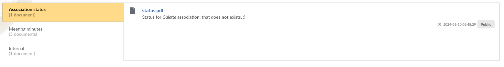
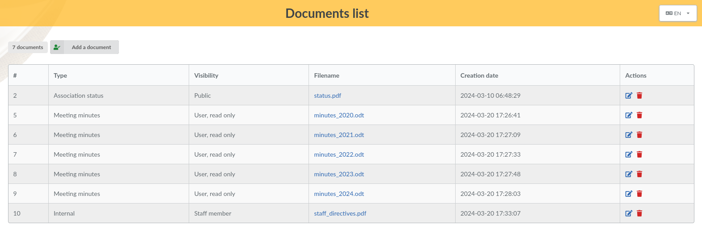
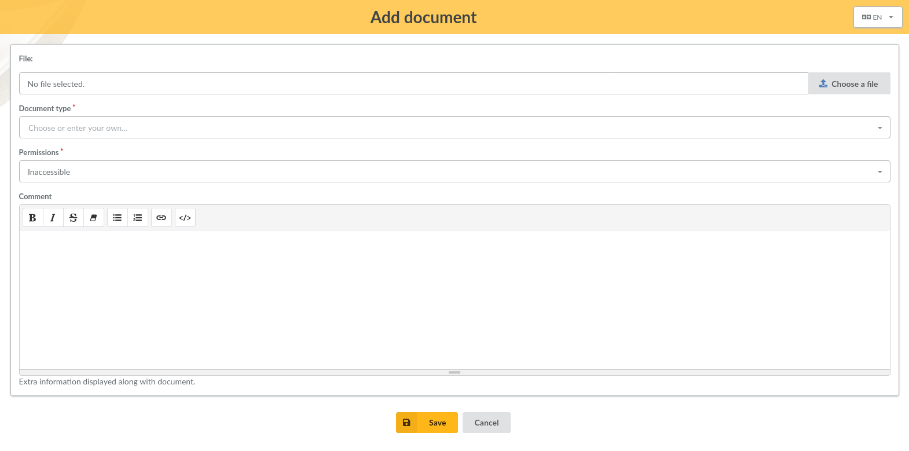
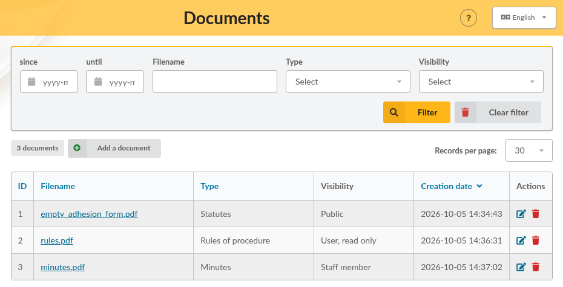
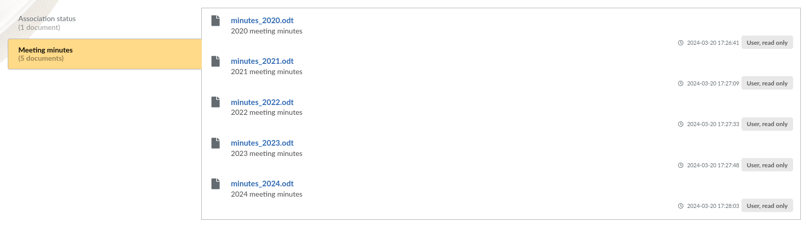
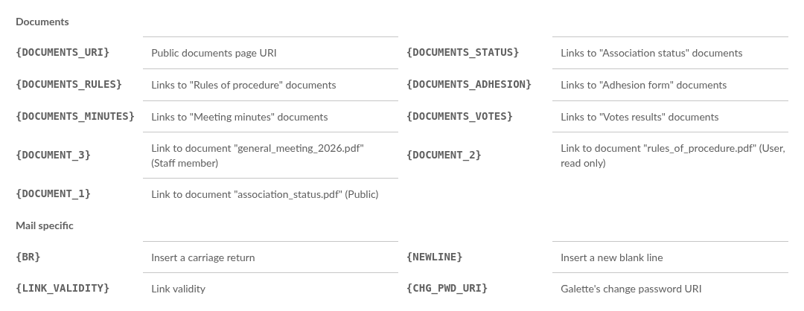

.. _documents:

*********
Documents
*********

.. versionadded:: 1.1.0

You can store and share administrative documents from Galette, like statuses, meeting minutes, and so on.

This is dispatched in two parts:

* **Documents management**: where you can add, edit, and delete documents - available from Management, Documents menu;
* **Public list**: where documents can be seen - available from Public pages, Documents menu.

Management
==========

The list can be filtered on the creation date, the filename, the type and the visibility of the documents. Click on **Filter** to apply the filters, and on **Clear filter** to come back to the whole list. When there are many documents, the list is displayed on several pages.

When creating or editing a document, you will of course choose a file to upload, a document type and a permission.

Several possible documents types are available from the list, you add a new one by just entering your text in the field.

Permissions will determine which documents will be displayed on public page; according to the user's rights.

Public list
===========

Documents public list is, as all public pages in Galette, related to "Show public pages" parameter from settings; but it's also related to specific access rights which has been set on each one.

On the above screenshot, a simple member is logged and can only see documents which are public and which are allowed for users. The internal document is restricted to staff members and therefore is not shown here.

.. _documents_replacements:

Links in emails and PDF
=======================

.. versionadded:: 1.3.2

Links to download documents can be added to :ref:`emails contents <emails_contents>`, to the :ref:`email signature <pref_email>` and to :ref:`PDF models <pdf_models>`: a link to the association status in the email sent to a new member, or to the rules of procedure in the membership form, for example. There is no need to copy and paste an address, that would break when a new version of the document is uploaded.

Three kinds of variables are available:

* ``{DOCUMENT_x}``: a link to one document, where ``x`` is the document number;
* ``{DOCUMENTS_STATUS}``, ``{DOCUMENTS_RULES}``, ``{DOCUMENTS_ADHESION}``, ``{DOCUMENTS_MINUTES}`` and ``{DOCUMENTS_VOTES}``: links to all the documents of a type, respectively association status, rules of procedure, adhesion form, meeting minutes and votes results. The variable is replaced by nothing if there is no document of this type;
* ``{DOCUMENTS_URI}``: the address of the documents public list.

You do not have to look for documents numbers: all those variables are listed in the **Documents** section of the inline help, next to the text you are editing, with the file name and the visibility of each document. Documents of a type you added yourself only get a ``{DOCUMENT_x}`` variable.

In PDF files, the link shows the file name and can be clicked. In emails, the file name is followed by the address of the document.

.. warning::

   Documents with the **Inaccessible** visibility are never proposed. Any other document is, whatever its visibility: check it before you send a link to people who could not open it. A visitor who does not have access to the document is sent back to the home page with an error message.
