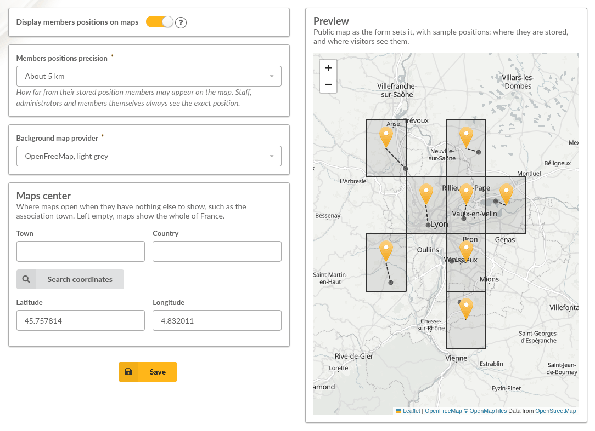
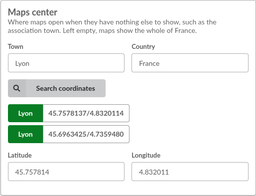
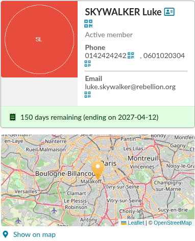
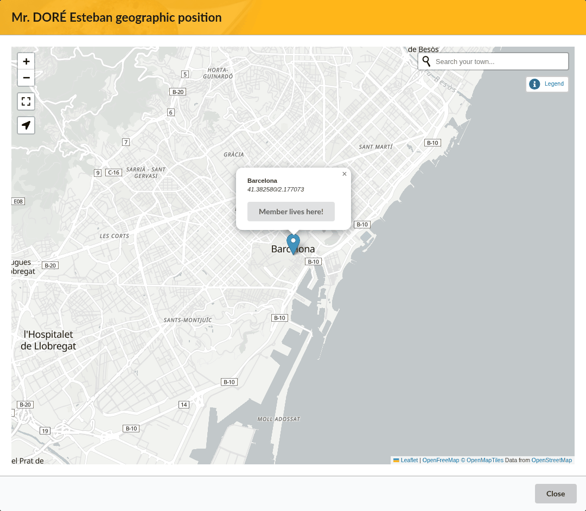
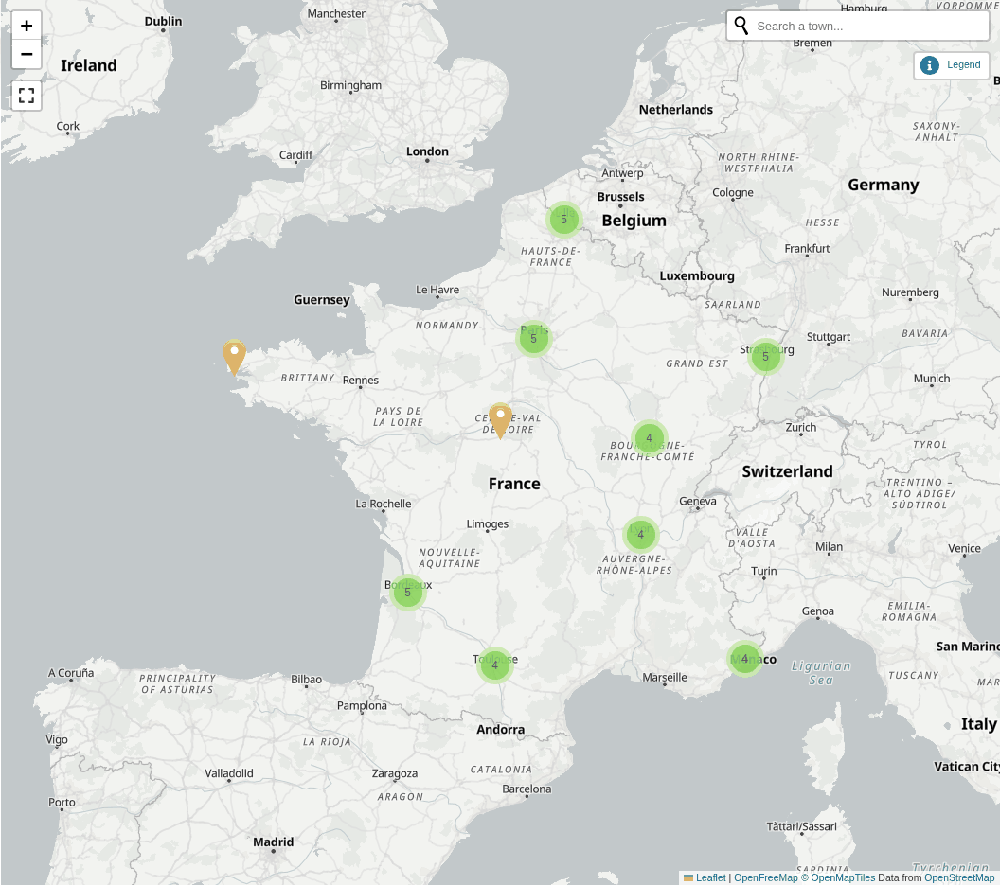

.. _maps:

****
Maps
****

.. versionadded:: 1.4.0

   Maps were provided by the Maps plugin before, see :ref:`maps_plugin`.

Galette can store where members live, as a geographical position (latitude and longitude). Positions are displayed on members cards, and on a public map of the members.

Maps are disabled on a new installation. Once they are enabled, members can set their own position, and so can those who are allowed to edit members.

.. _maps_settings:

Settings
========

Maps are set from **Configuration**, then **Maps settings**. This page requires the *Change settings* permission, which only administrators have by default.

Check **Display members positions on maps** to enable maps: menus entries, positions on members cards and the public map are only displayed once maps are enabled.

A **Preview** of the public map is displayed next to the settings. It follows the form as it is filled, before anything is saved: the background map, the maps center, and how far from their stored position members appear. Sample positions are displayed: a grey dot where a position is stored, a marker where visitors see it, and the square of the grid the position is snapped to.

.. _maps_precision:

Positions precision
-------------------

A member's stored position is often their home address. The map does not show it as is: positions are snapped to a grid, so a marker lands near the member, not on their door.

The precision is set with **Members positions precision**:

* **About 100 km**, **About 50 km**, **About 5 km**: for a region, a département or a town,
* **About 500 m**: the default, a neighbourhood,
* **About 50 m**: a street,
* **Exact position**: no snapping.

The value is how far, at most, a marker may be from the stored position.

Snapping applies on the public map, to visitors and to members who are not allowed to display the members concerned. Those allowed to display a member, with the *Display members* permission, see their exact position, and every member sees their own position, and those of their children, as they are stored.

When the map shows snapped positions, zooming stops at a level matching the precision, so that a marker does not seem to point at a precise address.

.. _maps_background:

Background map
--------------

The background map comes from a provider, chosen with **Background map provider**:

* **OpenFreeMap, light grey**: the default. Vector tiles, in a discreet grey that lets member markers stand out. No account, no API key, and the service can be `self-hosted <https://openfreemap.org>`_,
* **OpenFreeMap, colours**: the same service, rendered in full colour,
* **VersaTiles, colours** and **VersaTiles, grey**: vector tiles as well, from the `VersaTiles <https://versatiles.org>`_ project,
* **Plan IGN, France only**: the vector map of the French national geographic institute. It only covers France and its overseas territories: outside, the map remains empty,
* **OpenStreetMap**: the standard rendering, from the OpenStreetMap Foundation servers,
* **OpenStreetMap France** and **Humanitarian OSM Team**: hosted by the OSM-FR association; the second one gives more weight to roads and facilities,
* **OpenStreetMap Germany**: German rendering, favouring local names,
* **CyclOSM, for cycling**: cycleways, bicycle parkings and repair shops stand out,
* **OpenTopoMap, topographic**: contour lines and relief, for hiking or mountain clubs; it does not go down to the street level,
* **Esri, light grey**: a very light grey rendering.

Vector tiles need a browser able to render them (WebGL 2). Other browsers get the OpenStreetMap background instead. So do the maps next to members cards, which do not need more than a glance.

Maps never zoom further than their background map allows.

.. warning::

   Check the usage policy of the provider you choose. Most of them are run by associations or by volunteers, and they set conditions on the traffic they accept.

The last entry of the list, **Your own values**, replaces the proposed providers with an address of your own: a provider that is not listed, or your own tile server.

* **Vector tiles** tells Galette what it is being given: a MapLibre style when checked, classic raster tiles when not,
* **Address** is the style address for vector tiles, and the tiles address for raster ones, such as ``https://tile.openstreetmap.org/{z}/{x}/{y}.png``,
* **Attribution** is the credit the provider requires. HTML is allowed. It is not a formality: data licences make it mandatory,
* **Maximum zoom** is the deepest zoom level the provider serves. Going past it displays empty tiles,
* **Subdomains** lists the letters the ``{s}`` token of the address is replaced with, for instance ``abc``. Raster tiles only.

.. _maps_center:

Maps center
-----------

Maps open on the whole of France when they have nothing else to show: the public map before it frames members positions, or the map of a member who has no position yet. Set **Maps center** to have them open on your association town instead.

The **Town** and **Country** fields are filled with those of your association. Change them if needed, and use **Search coordinates**: the towns found are listed, choose one to fill **Latitude** and **Longitude**. Coordinates can also be typed in directly. Both are required, or none; leave them empty to show the whole of France again.

Towns are searched with the `Nominatim <https://nominatim.openstreetmap.org>`_ online service. Its answers are kept a week, so that a same town is not searched again.

.. _maps_positions:

Members positions
=================

Members set their own position from **My localization**, in the **My account** menu, or from the dashboard. The super administrator is not a member, and has no position.

The position of a member is displayed beside their card, both when displaying and when editing them; it opens the member map. When a member has no position yet, users allowed to edit them are offered to **Geolocalize** them.

The member map also opens from the **Geolocalize** action of the members list and of the member card. It is displayed in a window, over the page: a member form being filled is kept as it is.

There are several ways to find where a member lives:

* if a town has been set in the member information, the towns it matches are proposed, from the `Nominatim <https://nominatim.openstreetmap.org>`_ online service,
* the search field of the map looks for a place,
* the **Show me where I am** button uses the location the browser gives,
* and a click anywhere on the map.

Then, use **I live here!**, or **Member lives here!**, to store the position. Clicking on a stored position allows to remove it.

Members can always set their own position, and those of their children. Users with the *Edit members* permission set the position of the members they can edit. Those who can only display a member see their position, if there is one, with **Show on map**.

.. _maps_public:

Public map
==========

When maps are enabled, a **Maps** entry is added to the :ref:`public pages <man_public_pages>`, with a visibility of its own in the public pages settings. It displays up to date members who chose to be visible on public pages, and the members the logged-in user is allowed to display. Members of a company are displayed with a marker of their own; a click on a marker displays the member name.

.. _maps_plugin:

Coming from the Maps plugin
===========================

Maps replace the Maps plugin: it cannot be enabled any more, and is displayed as *Part of Galette now, can be removed* in the plugins list. Remove its directory from the ``plugins`` directory.

Positions stored with the plugin are taken over when Galette is updated, and maps are then enabled. The background map and the precision chosen with the plugin are kept.
