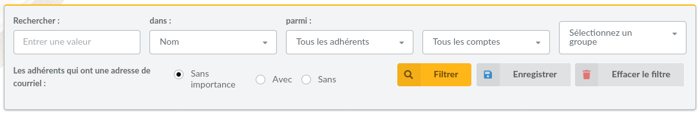
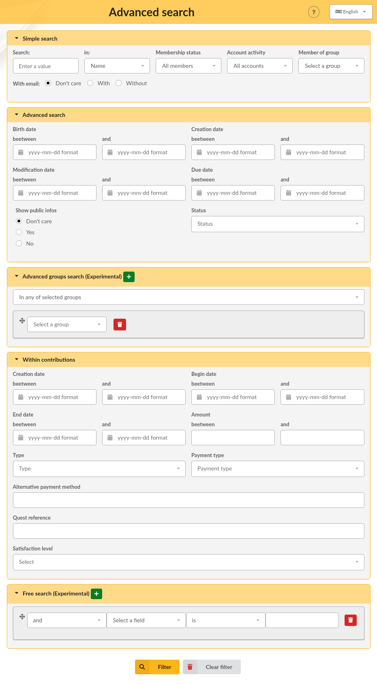
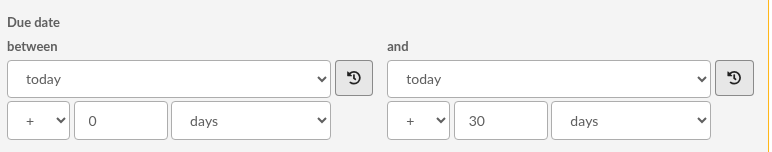
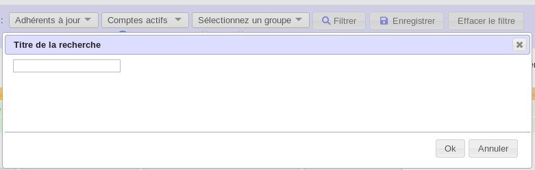
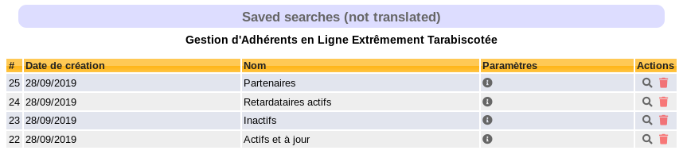

.. _search_galette:

******
Search
******

Every executed search will be conserved during your session. You can change a parameter or else, and come back to the list, you will find all your previous search parameters.

Filtering members list
======================

The form at the top of the members list allow you to make some search among members. The :ref:`advanced search <advsearch>` provides more criteria and possibilities.

You can filter on:

* a full text search on one of the following information:

  * name (first name, last name and nickname),
  * company name,
  * address (address, address continuation, zipcode, town and country),
  * email and instant messaging addresses (email address, website URL, and all direct messaging addresses),
  * job position,
  * information (public information and - for administrators only - private information).

* a member status:

  * all members,
  * up to date members,
  * closes expiries (members whose membership expires in 30 days)
  * latecomers,
  * members whose never had a membership,
  * staff members,
  * administrators.

* a status of the account:

  * all accounts,
  * active accounts,
  * inactive accounts.

* group affiliation,
* presence or absence of an email address.

All filters can be combined, giving you the ability to search among your active members whose have an email address and whose name contains a "a" ;)

.. _advsearch:

Advanced search
===============

Advanced search can be found in the main menu and propose an certain amount of fields types, related to members or their membership. The screen is separated into five parts (you can reduce individually):

* **simple search** which recall all filters present in the members list,
* **advanced search** which proposes extra fields on members that can be of use,
* **advanced groups search** (experimental) which allow to search members belonging to all, or to any, of several selected groups,
* **within contributions** allowing search on members contributions,
* **free search** (experimental) which allow to select any member field possible, including dynamic fields, and which will automatically adapt to selected field. You can add and remove lines to refine search.

.. _relative_dates:

Relative dates
--------------

.. versionadded:: 1.3.1

Every date of the advanced search can be a date relative to the day the search is run, instead of a fixed date. This applies to the dates of the **advanced search** and **within contributions** parts, to the date fields of the **free search**, including dynamic fields, and to the date dynamic fields of contributions.

Click on the button next to a date field to switch to a relative date, and click on it again to come back to a fixed date. A relative date is a reference date, optionally shifted by a number of days, weeks, months or years, forward (``+``) or backward (``-``). Reference dates are:

* **today**,
* **start of the month** and **end of the month**,
* **start of the year** and **end of the year**,
* **start of the membership period** and **end of the membership period**.

The membership period is only known when memberships share the same beginning date (**Beginning of membership** in :ref:`preferences <pref_parameters>`). When memberships are extended for a number of months from the contribution instead, there is no common period, and those two reference dates are not offered.

Some examples:

* **Insurance certificates expiring within a month**: on a date dynamic field, a due date between *today* and *today + 1 month*,
* **Adult members**: birth date before *today - 18 years*,
* **Contributions of the current period**: contribution begin date after *start of the membership period*.

A relative date is computed again each time the search is run: a :ref:`saved search <saved_searches>` using *today + 30 days* always lists what is due within 30 days, whatever the day it is executed. Months and years are added calendar-wise: one month after January 31st is the last day of February.

.. _saved_searches:

Saved searches
==============

.. versionadded:: 0.9.3

Every search on members can be stored (with a name) in order to be executed again later. They are accessible only for their author.

After you proceed a search ("simple" or "advanced"), just click on the "Save" button, and pick up a name.

You can find saved searches in the list:

From this list, you will be able to remove or execute again searches, and also see a detail of used criteria. :ref:`Relative dates <relative_dates>` are shown in plain words, followed by the date they currently stand for.

.. versionchanged:: 1.3.1

A saved search can be edited from the list: you can rename it, and replace its criteria with the advanced search you are currently using on the members list.

When a saved search is executed, criteria referring to something that no longer exists, such as a removed group, status, contribution type, payment type or dynamic field, are ignored, and a message lists them. Check the search before using it, for example to send a mailing: without those criteria, it may select more members than expected.

Dates of saved searches are stored independently of the language, a search saved in one language can be executed in another one.
