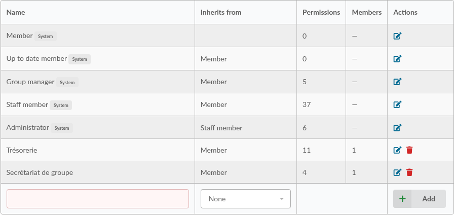
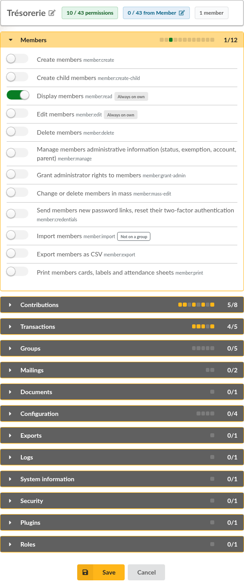
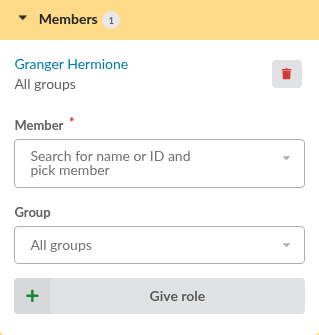
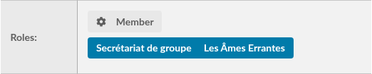
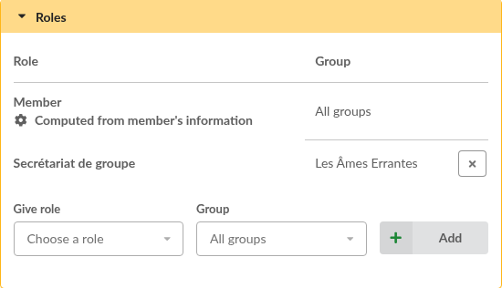

.. _roles:

*****
Roles
*****

.. versionadded:: 1.4.0

What a user is allowed to do in Galette is described by **permissions**, such as *Display members*, *Create contributions* or *Send mailings*. Permissions are not given one by one to users: they are gathered in **roles**, and roles are given to members.

Some roles are given automatically, from members information: they reproduce the access levels of previous versions (members, group managers, staff members, administrators). You can change their permissions, and create your own roles, for a treasurer or a secretary for instance, to give to whom you choose, for all the groups or for one group only.

Roles are managed from **Configuration**, then **Roles**; only administrators can reach this page.

System roles
============

Five roles are given from members information; they cannot be renamed, removed nor given by hand:

.. list-table::
   :header-rows: 1
   :widths: 20 40 20

   * - Role
     - Given to
     - Inherits from
   * - **Member**
     - any logged in member
     -
   * - **Up to date member**
     - members whose account is active and whose membership is up to date
     - Member
   * - **Group manager**
     - managers of a group, on the groups they manage only
     - Member
   * - **Staff member**
     - members with a staff status (President, Treasurer, Secretary...)
     - Member
   * - **Administrator**
     - members for who the *administrator* checkbox has been checked
     - Staff member

A role **inherits** the permissions of its parent: an administrator gets every permission of staff members, and those of members.

On a new installation, system roles get what access levels allowed before:

* **Member** and **Up to date member**: no permission. Members still see and edit their own information, and see their own contributions and transactions, see :ref:`below <roles_own>`,
* **Group manager**: display the members and the groups they manage, export those members as CSV, print their cards, labels and attendance sheets, export their groups as PDF,
* **Staff member**: everything about members, contributions, transactions, groups, mailings and documents, references lists (statuses, titles, contributions and payment types), emails contents and PDF models, data exports, logs and system information,
* **Administrator**: in addition, grant administrator rights to members, settings, fields configuration, authentication restrictions, plugins and roles.

When upgrading, they get what your former settings allowed, see :ref:`roles_upgrade`.

The **super administrator** is not a member, and has no role: it is always granted everything.

.. _roles_own:

What members own
----------------

Some permissions are always granted on what a member owns: their own information, contributions and transactions, and those of their children. They are flagged **Always on own** in the permissions lists. This cannot be changed: a member can always see their own card, even if the **Member** role has no permission at all.

Roles list and edition
======================

The roles list displays each role, the role it inherits from, the number of permissions it grants (inherited ones are not counted) and how many members it has been given to. System roles are flagged as such.

Type a name at the bottom of the list and use **Add** to create a role; you can choose the role it inherits from. A role can inherit from a system role or from another role you have created; a parent that would make the role inherit from itself is refused.

Editing a role displays its name and the role it inherits from, then its permissions, gathered by domain (members, contributions, transactions, groups, mailings, configuration...). Check the permissions the role grants, and **Save**. Permissions the role inherits from its parent are checked and cannot be unchecked here: change the parent role instead.

Plugins may add their own permissions, in a domain of their own. Permissions of a plugin you disable are kept, and come back when the plugin is enabled again.

Giving a role
=============

Roles you have created are given from their edition page, under **Members**: choose a member, a group or **All groups**, and use **Give role**. The same role can be given to a member for several groups. The trash icon takes a role back. Roles can also be given when editing a member, see below.

Changes apply at once: there is no need for the member to log in again.

Administrators see the roles of a member on their card: those computed from member information, with a cog icon, and those you have given, in blue. Each one links to the role page.

When editing a member, the **Roles** block lists the same roles. Computed ones cannot be changed there. Choose one of the roles you have created, a group or **All groups**, and use **Add**; the cross takes a given role back, and **Cancel** keeps it. Changes are stored when the member is saved.

Roles for one group
-------------------

A role given for one group grants its permissions on the members of that group only, as for group managers: on their information, their contributions and their transactions. The lists of members, contributions and transactions only display those members. Groups are not inherited: a role for a group does not cover its subgroups.

.. warning::

   Some permissions do not apply to members: configuration, references lists, logs, plugins, roles... They have no group to be limited to; a role given for one group grants them **entirely**. Only give such permissions in roles you give for all groups.

Examples
========

A treasurer
   Create a *Treasurer* role with all the permissions of the **Contributions** and **Transactions** domains, and *Display members* so the members can be chosen in forms. Give it for all groups to the member in charge of the accounts. They will not be able to edit members.

A secretary for a section
   Create a *Section secretary* role with *Display members*, *Edit members*, *Display groups* and *Send mailings*. Give it for the section group: the member can update the information of the section members and write to them, and nobody else.

Members who register their children
   Check *Create child members* in the **Member** role: every logged in member gets an **Add a child member** entry; created members are attached to them as children.

Group managers who update their members
   Check *Edit members* in the **Group manager** role: every group manager can then edit the members of the groups they manage.

.. _roles_upgrade:

Upgrading from 1.3
==================

Before 1.4, a few settings in the :ref:`rights tab of preferences <pref_rights>` gave group managers and members extra rights. When upgrading, each setting that was enabled is turned into permissions of the matching system role, then the setting is removed:

.. list-table::
   :header-rows: 1
   :widths: 40 20 40

   * - Former setting
     - Role
     - Permissions
   * - Can members create child?
     - Member
     - Create child members
   * - Can group managers edit their groups?
     - Group manager
     - Edit groups
   * - Can group managers create members?
     - Group manager
     - Create members
   * - Can group managers edit members?
     - Group manager
     - Edit members
   * - Can group managers send mailings?
     - Group manager
     - Send mailings
   * - Can group managers do exports?
     - Group manager
     - Export members as CSV; print members cards, labels and attendance sheets; export groups as PDF
   * - Can group managers see contributions?
     - Group manager
     - Display contributions; attach contributions to transactions
   * - Can group managers create contributions?
     - Group manager
     - Create contributions; attach contributions to transactions
   * - Can group managers see transactions?
     - Group manager
     - Display transactions
   * - Can group managers create transactions?
     - Group manager
     - Create transactions

Nothing changes for users: everyone keeps what they were allowed to do. After the upgrade, open **Configuration**, then **Roles**, and check the **Group manager** and **Member** roles match what you expect.

A few differences with previous versions:

* staff members now see the **Configuration** menu, with the references lists and the emails and PDF models they could already reach,
* *Create members* and *Create child members* are two permissions: a member allowed to register their children no longer sees **Add a member**.

What roles do not cover
=======================

* which fields of member cards each level can see or change, still set in :ref:`fields configuration <fields_acls>`,
* documents visibility, set on each document,
* public pages, set in preferences,
* pages reserved to the super administrator, such as the advanced configuration,
* plugins that have not been updated yet: they keep working with access levels.
